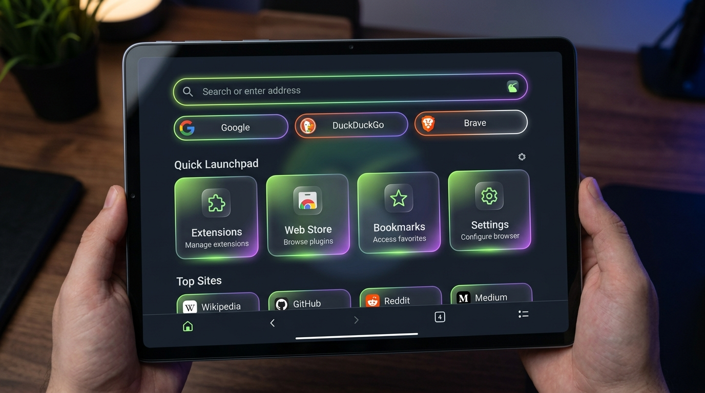

<p align="center">
  
</p>

<h1 align="center">Kiwi Browser (Revived Edition)</h1>

<p align="center">
  <strong>Fast, customizable Chromium browser for Android with full Chrome Extensions support, crash fixes for Android 14/HyperOS, and refreshed Material 3 UI.</strong>
</p>

<p align="center">
  <a href="https://github.com/EduBolthey/kiwi-browser/releases"></a>
  
  
  
</p>

---

## 📱 Visual Showcase & Tablet Experience

<p align="center">
  
</p>

<p align="center">
  <em>Kiwi Browser Revived running on Xiaomi Pad 6 (Android 14 / HyperOS) showcasing the new Material 3 Glassmorphism New Tab Page, Search Engine Switcher, and Quick Launchpad.</em>
</p>

---

## ⚡ What is Kiwi Browser Revived?

Kiwi Browser was one of the most loved Chromium forks on Android, pioneering desktop extension support, night mode, and bottom address bars. Following the upstream archive in early 2025, modern Android versions (Android 14 / HyperOS) introduced UI changes that caused frequent crashes when tapping the address bar (Omnibox) on tablets, and the original build servers went offline.

**Kiwi Browser Revived** resolves these issues, modernizes the UI, updates Chrome Web Store integration, and provides a 100% standalone build and release pipeline.

---

## 🚀 Key Fixes & Improvements

### 1. 🛡️ Tablet Address Bar (Omnibox) Crash Fix (Android 14 / HyperOS)
* **Root Cause Fixed**: Tapping the URL bar on Xiaomi Pad 6 and other tablets triggered `NullPointerException` and `ClassCastException` inside `LocationBarTablet` during width change animations and touch offset calculations.
* **Resolution**: Added defensive bounds-checking, verified view hierarchy instances before casting in `LocationBarMediator`, and wrapped touch event handlers in `UrlBar` and `LocationBarTablet` to prevent system-level UI crashes.

### 2. 🎨 Refreshed Material 3 New Tab Page
* **Glassmorphic Aesthetic**: Translucent frosted-glass cards with dynamic glowing accents and smooth micro-interactions.
* **Integrated Search Switcher**: Instant one-tap toggle between **Google, DuckDuckGo, Brave, Bing, and AI Assistant**.
* **Quick Launchpad**: Direct tiles for **Extensions Manager, Chrome Web Store, Bookmarks, History, Downloads, and Settings**.
* **Live Clock & Adaptive Layout**: Fluid grid automatically adapts between portrait phones and landscape tablets.

### 3. 🧩 Modern Chrome Web Store Support
* Updated store URL routing in `PersonalizeResults.java` to support Google's new `chromewebstore.google.com` store domain, enabling direct one-click extension installs without desktop-mode redirects.

### 4. 📦 Decoupled Standalone Build Pipeline
* Removed all dependencies on the defunct `longbuild.find.kiwi` server.
* Self-contained GitHub Actions workflow (`.github/workflows/build_kiwi_standalone.yml`) and local build script (`build_kiwi.sh`) that generate signed APKs and publish directly to GitHub Releases.

---

## 📥 Downloads (APKs)

All pre-built APK releases are available directly in the **Releases** section:

👉 **[Download the Latest APK from Releases](https://github.com/EduBolthey/kiwi-browser/releases)**

| Package | Target Architecture | Recommended Devices |
| :--- | :--- | :--- |
| `com.kiwibrowser.browser-arm64.apk` | 64-bit ARM (ARMv8-A) | Xiaomi Pad 6, modern phones & tablets |
| `com.kiwibrowser.browser-arm.apk` | 32-bit ARM (ARMv7-A) | Older Android devices |
| `com.kiwibrowser.browser-x64.apk` | 64-bit x86 | Chromebooks, Android emulators |
| `com.kiwibrowser.browser-x86.apk` | 32-bit x86 | Legacy x86 hardware |

---

## 🛠️ Building From Source

### Option 1: Automatic Build via GitHub Actions (Cloud)
1. Go to your repository's **Actions** tab on GitHub.
2. Select **Kiwi: Standalone Build APK**.
3. Choose your architecture (`arm64`, `arm`, `x64`, `x86`) and click **Run workflow**.
4. The workflow will compile and upload the APK directly to the **Releases** section.

### Option 2: Local Compilation (Linux / WSL2)
```bash
# 1. Install prerequisites (Ubuntu 20.04 / 22.04 or WSL2)
sudo apt-get update
sudo apt-get install -y python3 python-is-python3 openjdk-11-jdk-headless ninja-build ccache curl git

# 2. Run the build script
chmod +x build_kiwi.sh
./build_kiwi.sh arm64
```
The output APK will be placed in:
```
out/android_arm64/apks/ChromePublic.apk
```

---

## 📄 License
Kiwi Browser is open-source under the Chromium [BSD 3-Clause License](LICENSE).
