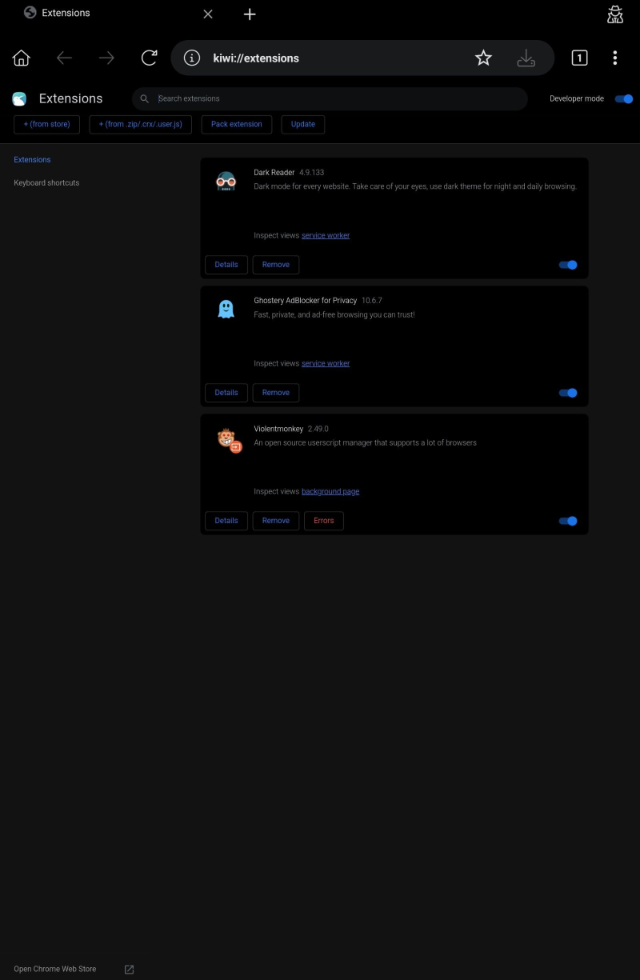
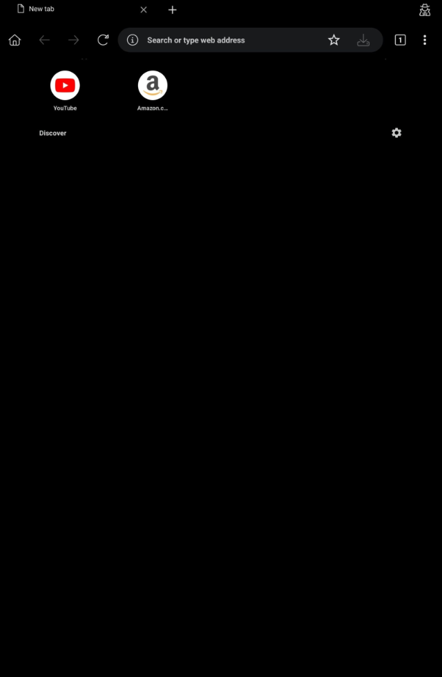
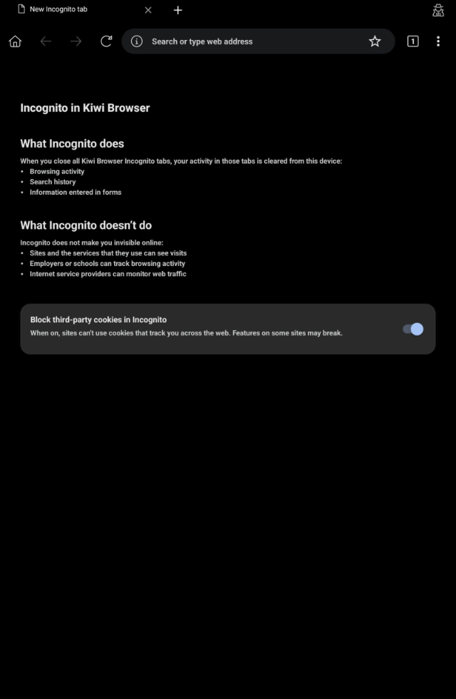

<p align="center">
  
</p>

<h1 align="center">Kiwi Browser (Revived Edition)</h1>

<p align="center">
  <strong>Actively maintained, privacy-hardened Chromium browser for Android with full Desktop Chrome Extensions (MV2 &amp; MV3), Android 14/15 &amp; HyperOS Tablet stability, and a zero-telemetry Material 3 Glassmorphic UI.</strong>
</p>

<p align="center">
  <a href="https://github.com/EduBolthey/Kiwi-Browser-Revived/releases"></a>
  <a href="https://github.com/EduBolthey"></a>
  
  
  
</p>

---

## 📱 Real Tablet Screenshots (Desktop Extensions, New Tab & Incognito)

| 🧩 **Desktop Extensions (`kiwi://extensions`)** | 🏠 **New Tab (`chrome://newtab`)** | 🕵️ **Incognito Mode (`Private Tab`)** |
| :---: | :---: | :---: |
|  |  |  |

> 💡 **Live Interactive HTML/CSS Preview**: You can also open [`docs/index.html`](docs/index.html) or [`chrome/browser/resources/new_tab_page_instant/modern_ntp.html`](chrome/browser/resources/new_tab_page_instant/modern_ntp.html) directly in any browser to test the interactive Material 3 New Tab Page.

### UI Design System & Component Structure

The New Tab Page (`local_ntp.html`, `modern_ntp.html`) and Stealth Private Mode (`incognito_ntp.html`) are built with a **100% local, zero-network HTML5 + CSS3 Custom Properties architecture**—eliminating external Google Fonts, third-party favicon trackers, and remote script execution:

```text
<AppShell data-theme="aurora | oled | daylight">
 ├── <TopBar>
 │    ├── <BrandCluster badge="Revived" />
 │    ├── <PrivacyShieldTrigger status="Protected (Zero Telemetry)" />
 │    └── <ThemeCycleButton modes={["Aurora", "OLED Black", "Daylight"]} />
 ├── <HeroClock format="12h | 24h" greeting="Contextual local time" />
 ├── <OmniboxSearch>
 │    ├── <SmartQueryParser supports={["URL auto-routing", "!g", "!ddg", "!br", "!gh", "!w", "!yt"]} />
 │    └── <EngineSwitcher engines={["Google", "DuckDuckGo", "Brave", "Startpage", "Bing", "AI Search"]} />
 ├── <QuickLaunchpad columns={4}>
 │    ├── chrome://extensions            (Desktop Extension & CRX Manager)
 │    ├── chromewebstore.google.com      (Direct 1-Click Web Store Install)
 │    ├── chrome://bookmarks             (Favorites & Folders)
 │    └── chrome://settings              (Toolbar, Privacy & Night Mode)
 ├── <LocalSpeedDial storage="localStorage (Zero Cloud Sync)">
 │    ├── <SitePill badge="Local Vector Monogram" />
 │    └── <SpeedDialControls actions={["+ Add Site", "Edit / Unpin", "Export JSON", "Import JSON"]} />
 └── <UtilityDock links={["chrome://history", "chrome://downloads", "chrome://flags", "chrome://inspect"]} />
```

```css
/* Core Material 3 Glassmorphic Design Tokens (Zero External Assets) */
:root {
  --bg-primary: #0b101e;
  --bg-surface: rgba(20, 28, 46, 0.72);
  --accent-kiwi: #4ade80;
  --accent-cyan: #38bdf8;
  --accent-violet: #a855f7;
  --accent-gradient: linear-gradient(135deg, #4ade80 0%, #38bdf8 50%, #a855f7 100%);
  --blur-glass: blur(18px);
}
```

---

## ⚡ Why Kiwi Browser (Revived Edition)?

Following the archiving of the original upstream repository in early 2025, **Kiwi Browser (Revived Edition)**—maintained by **[@EduBolthey](https://github.com/EduBolthey)**—continues active development as an ongoing, privacy-hardened Android browser release.

### 1. 🔒 Privacy & Cookie Isolation Hardening
* **Strict Origin Cookie Isolation**: Stripped legacy `Access-Control-Allow-Credentials: true` and `Access-Control-Allow-Origin: chrome-search://local-ntp` header injections in [`HttpNetworkTransaction`](net/http/http_network_transaction.cc) and removed background `credentials: 'include'` requests so your session cookies never leave the site you visit.
* **No Remote Script `eval()`**: Removed legacy third-party GitHub script fetching and `eval()` execution from [`new_ntp.html`](chrome/browser/resources/new_tab_page_instant/new_ntp.html).
* **Zero Background Telemetry**: Disabled remote search engine overrides ([`SearchURLFetcher`](components/search/search_url_fetcher.cc)), sponsored tile fetches (`tiles.kiwibrowser.org`), and external domain icon lookups (`logos.kiwibrowser.com`).

### 2. 🛡️ Android 14 / 15 & HyperOS Tablet Omnibox Crash Fix
* **Root Cause Fixed**: Tapping the address bar on tablets (such as Xiaomi Pad 6 on Android 14 / HyperOS) triggered fatal `NullPointerException` and `ClassCastException` crashes inside `LocationBarTablet` and `LocationBarMediator`.
* **Resolution**: Added null-safe view bounds checks, verified view hierarchy types prior to casting, and hardened touch/focus listeners in [`LocationBarTablet.java`](chrome/browser/ui/android/omnibox/java/src/org/chromium/chrome/browser/omnibox/LocationBarTablet.java), [`LocationBarMediator.java`](chrome/browser/ui/android/omnibox/java/src/org/chromium/chrome/browser/omnibox/LocationBarMediator.java), [`UrlBar.java`](chrome/browser/ui/android/omnibox/java/src/org/chromium/chrome/browser/omnibox/UrlBar.java), and [`AutocompleteMediator.java`](chrome/browser/ui/android/omnibox/java/src/org/chromium/chrome/browser/omnibox/suggestions/AutocompleteMediator.java).

### 3. 🧩 Desktop Chrome Web Store & Interactive Toolbar Settings
* **Modern Chrome Web Store**: Updated [`PersonalizeResults.java`](chrome/android/java/src/org/chromium/chrome/browser/PersonalizeResults.java) to natively support `chromewebstore.google.com` for one-tap desktop extension installation.
* **Full Toolbar Customization**: Built interactive preferences in [`ToolbarSettings.java`](chrome/android/java/src/org/chromium/chrome/browser/settings/ToolbarSettings.java) for **Bottom Address Bar**, **Toolbar Swipe Gestures**, **Keep URL in Address Bar on Tap**, **Pin Extensions to Top of Menu**, and **Tab Switcher Quick Menu**.

---

## 📥 Downloads (Latest Signed APKs)

All pre-built, privacy-audited APK releases are published directly in [**GitHub Releases**](https://github.com/EduBolthey/Kiwi-Browser-Revived/releases):

👉 **[Download Latest APK from Releases](https://github.com/EduBolthey/Kiwi-Browser-Revived/releases/latest)**

| Package Variant | Architecture | Signing & Co-Installation | Recommended For |
| :--- | :--- | :--- | :--- |
| `com.kiwibrowser.browser-arm64-v1.0.0-revived.apk` | `arm64-v8a` (64-bit) | Standard Release (`com.kiwibrowser.browser`) | Primary daily driver on modern phones & tablets |
| `com.kiwibrowser.browser.dev-arm64-v1.0.0-revived.apk` | `arm64-v8a` (64-bit) | Side-by-Side Edition (`com.kiwibrowser.browser.dev`) | Installing alongside an existing Kiwi installation |

---

## 🗺️ Ongoing Maintenance & Release Roadmap

**Kiwi Browser (Revived Edition)** is actively maintained with continuous updates:

| Area | Status | Details |
| :--- | :---: | :--- |
| **Privacy & Cookie Isolation Audit** | ✅ Completed | Removed CORS credential bypasses, remote `eval()`, and background telemetry |
| **Material 3 Glassmorphic NTP & Stealth Incognito** | ✅ Completed | 100% offline UI, multi-engine switcher, `!bangs`, and JSON backup |
| **Android 14/15 & HyperOS Tablet Omnibox Fix** | ✅ Completed | Null-safe `LocationBarTablet`, `LocationBarMediator`, and `UrlBar` |
| **Modern Chrome Web Store (`chromewebstore.google.com`)** | ✅ Completed | Direct desktop extension installation without redirect loops |
| **Ongoing Extension API & Security Patches** | 🔄 Active | Continuous stability, WebView/Chromium security backports, and UI refinements |

---

## 🛠️ Building From Source

### Option 1: GitHub Actions Standalone Cloud Pipeline
1. Open the **Actions** tab in [`EduBolthey/kiwi-browser`](https://github.com/EduBolthey/Kiwi-Browser-Revived/actions).
2. Select **Kiwi: Standalone Build APK** (`.github/workflows/build_kiwi_standalone.yml`).
3. Choose your target architecture (`arm64`, `arm`, `x64`, `x86`) and click **Run workflow**.

### Option 2: Local Build (Linux / WSL2)
```bash
sudo apt-get update
sudo apt-get install -y python3 python-is-python3 openjdk-11-jdk-headless ninja-build ccache curl git
chmod +x build_kiwi.sh
./build_kiwi.sh arm64
```

---

## 👨‍💻 Maintainer & Contributors

<table>
  <tr>
    <td align="center">
      <a href="https://github.com/EduBolthey">
        <br />
        <sub><b>@EduBolthey</b></sub>
      </a><br />
      <sub>Lead Maintainer • Kiwi Browser (Revived Edition)</sub>
    </td>
  </tr>
</table>

* Contributions, bug reports, and pull requests are welcome at [github.com/EduBolthey/Kiwi-Browser-Revived](https://github.com/EduBolthey/Kiwi-Browser-Revived).

---

## 📄 License

Kiwi Browser (Revived Edition) is open-source software licensed under the [BSD 3-Clause License](LICENSE).
